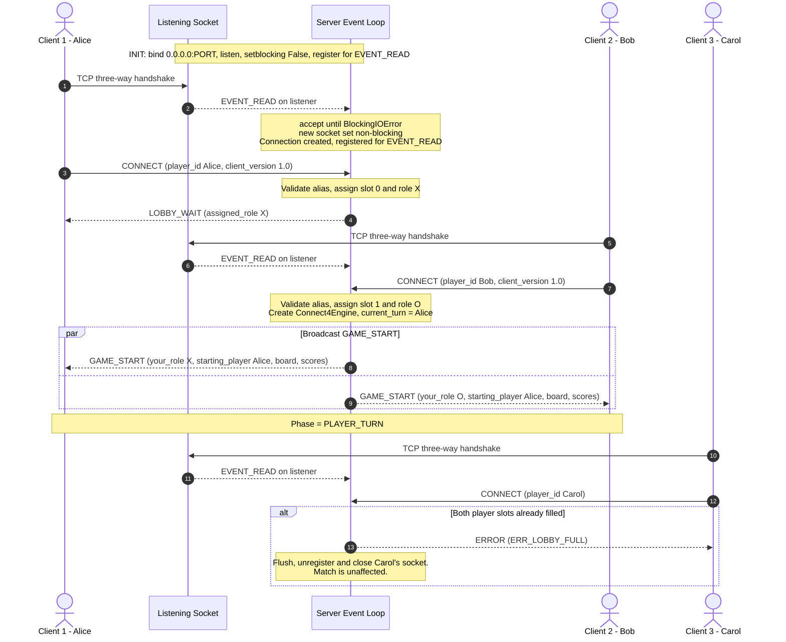
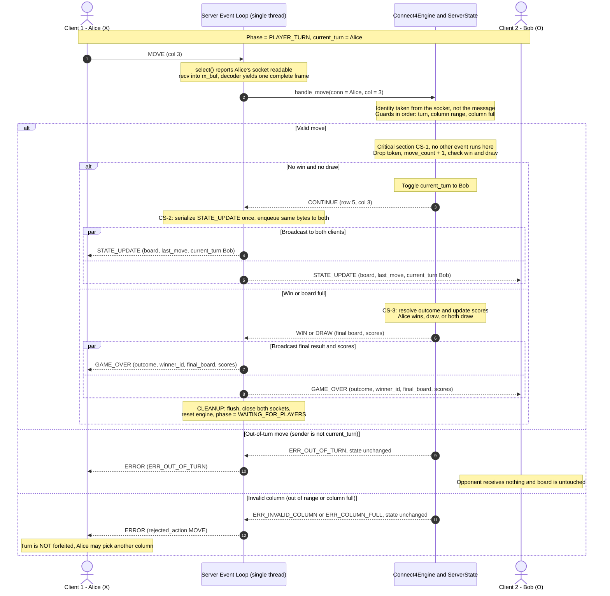
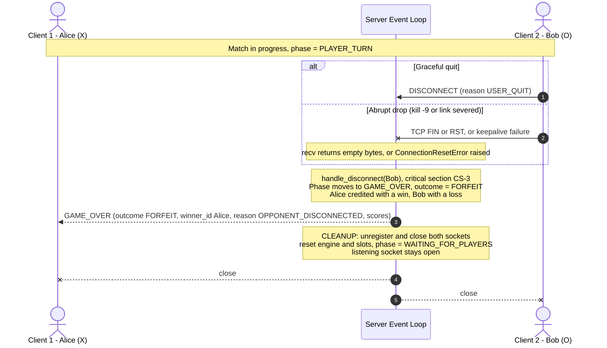

# Sprint 2: Server Concurrency & Game Behavior Architecture: Connect 4 (C4P)

**Student:** Mitchel Mata
**Course:** CS 457 - Computer Networks
**Sprint:** 2 (October 05 - October 18)
**Game:** Networked 2-player Connect 4 (6 x 7 board), console/ASCII client
**Language:** Python 3 (standard library only)
**Related documents:** `docs/protocol_blueprint.md` (C4P wire protocol), `docs/fsm_specification.md` (server FSM)

---

## 0. Rubric Traceability

| Rubric Criterion | Where It Is Addressed |
| :--- | :--- |
| 1. Server Concurrency Architecture & Connection Lifecycle | Sections 2, 3, 4, 5 |
| 2. Thread Safety, Lock Acquisition & State Isolation | Section 6 |
| 3. Mermaid `sequenceDiagram` syntax | Sections 4.2, 7.2, 9 (three diagrams) |
| 4. Move Validation, Turn Enforcement & State Broadcast | Sections 7, 8 |

---

## 1. Overview & Design Goals

The server hosts one Connect 4 match at a time between two clients (Player 1 = `X`, Player 2 = `O`). It must:

1. Service at least two simultaneous client connections **without blocking** its main loop.
2. Treat the server as the **single authority** for the board, the active turn, and the scores.
3. Reject out-of-turn or illegal moves **without altering any game state**.
4. Deliver every state change and score update to **both** clients, using identical content and ordering.
5. Survive client disconnects (graceful or abrupt) and return to a clean lobby without restarting the process.

---

## 2. Server Concurrency Model Selection

### 2.1 Decision: Option B, Non-Blocking I/O Multiplexing with `selectors`

The server runs a **single-threaded event loop** built on `selectors.DefaultSelector` (epoll on Linux CML nodes). Every socket (the listening socket and each client socket) is set to non-blocking mode with `sock.setblocking(False)` and registered with the selector. One thread waits in `selector.select()` and dispatches whichever sockets are ready.

### 2.2 Justification

| Concern | Option A: Thread per client + `threading.Lock` | Option B: `selectors` event loop (chosen) |
| :--- | :--- | :--- |
| Shared game state | Board, turn, scores, and client list are touched by multiple threads and need locks everywhere | Only one thread ever touches state, so there is nothing to lock |
| Race conditions | Possible (two threads evaluating `MOVE` at once) unless every critical section is correct | Impossible by construction as long as handlers never block or spawn threads |
| Turn-order determinism | Depends on lock acquisition order, which the OS scheduler decides | Events are processed one at a time in a defined order |
| Deadlock risk | Present (broadcast needs the client-list lock and the game lock) | None |
| Fit with FSM | Each thread can be in a different place in the FSM | There is exactly one FSM instance advanced by one thread |
| Scale needed | Overkill: 2 players | Ideal: 2 players plus a few transient connections |
| Debuggability in CML / Wireshark | Interleaved log lines from several threads | Linear, reproducible log of events |

### 2.3 Why Not `select()` + the Blocking `recv_exact()` from Sprint 1

The Sprint 1 transport reference (`recv_exact`) loops on `sock.recv()` until `N` bytes arrive. That is correct for a **blocking** client socket, but unsafe on the server's event loop:

- On a **non-blocking** socket, `recv()` raises `BlockingIOError` whenever no data is currently available, which `recv_exact` does not handle.
- On a **blocking** socket that `select()` reported readable, `recv_exact` could still stall the whole server waiting for the rest of a half-sent frame. One slow or malicious client would freeze the game for both players (head-of-line blocking).

**Resolution:** the server uses a per-connection **receive buffer plus incremental frame decoder** (Section 5.1) that implements the same C4P framing rule (4-byte big-endian length prefix, then JSON payload, 64 KiB cap, EOF handling) but never waits. The blocking `recv_exact` / `receive_c4p_message` / `send_c4p_message` from `network_transport.py` remain in use by `client.py`, where blocking is acceptable.

---

## 3. Server Components & Data Structures

```text
+--------------------------------------------------------------+
|                      Server (one thread)                     |
|                                                              |
|  selector ----> Event Loop ----> Dispatcher                  |
|                                    |                         |
|        accept_ready()  read_ready()  write_ready()           |
|                                    |                         |
|                                    v                         |
|        handle_connect / handle_move / handle_disconnect      |
|                                    |                         |
|                                    v                         |
|                  ServerState + Connect4Engine                |
|        (phase, players, board, turn, scores)                 |
+--------------------------------------------------------------+
```

```python
class Phase(Enum):
    WAITING_FOR_PLAYERS = auto()
    PLAYER_TURN = auto()
    # INIT, GAME_START, EVALUATE_MOVE, GAME_OVER and CLEANUP are transient:
    # each runs to completion inside a single event handler call.

@dataclass
class Connection:
    sock: socket.socket
    addr: tuple
    rx_buf: bytearray        # bytes received but not yet decoded into frames
    tx_buf: bytearray        # encoded frames waiting to be sent
    alias: str | None        # set after a valid CONNECT
    slot: int | None         # 0 = Player 1 (X), 1 = Player 2 (O)
    connected_at: float      # used for the handshake timeout
    closed: bool = False     # guards against stale events in the same select() batch

@dataclass
class ScoreRecord:
    wins: int = 0
    losses: int = 0
    draws: int = 0

class ServerState:
    phase: Phase
    conns: dict[socket.socket, Connection]   # every open client socket
    players: list[Connection | None]         # length 2, indexed by slot
    engine: Connect4Engine | None            # board, move_count, current_turn
    scores: dict[str, ScoreRecord]           # alias -> cumulative record (in memory)
```

---

## 4. Connection Lifecycle

### 4.1 Stages

| Stage | FSM State | What Happens | Code Path |
| :--- | :--- | :--- | :--- |
| 1. Listen | `INIT` | Create the TCP socket, set `SO_REUSEADDR`, `bind(("0.0.0.0", PORT))`, `listen(5)`, `setblocking(False)`, register for `EVENT_READ` with `data=None` | `Server.start()` |
| 2. Accept | `WAITING_FOR_PLAYERS` | Listener becomes readable. Call `accept()` in a loop until `BlockingIOError`. Set the new socket non-blocking, enable `SO_KEEPALIVE`, create a `Connection` (unregistered, no alias), register for `EVENT_READ` | `accept_ready()` |
| 3. Register | `WAITING_FOR_PLAYERS` | First frame must be `CONNECT`. Validate alias (1-16 alphanumeric characters, not already in use). Assign the next free slot and role. Player 1 receives `LOBBY_WAIT` | `handle_connect()` |
| 4. Start | `GAME_START` | When both slots are filled: create `Connect4Engine(p1, p2)`, then broadcast `GAME_START` to both clients | `start_match()` |
| 5. Service | `PLAYER_TURN` and `EVALUATE_MOVE` | Each `MOVE` is validated, applied, and answered with `STATE_UPDATE` (both clients) or `ERROR` (sender only) | `handle_move()` |
| 6. Finish | `GAME_OVER` | Win, draw, or forfeit is resolved. Scores are updated and `GAME_OVER` is broadcast | `finish_match()` |
| 7. Teardown | `CLEANUP` | Flush pending output, unregister and close both sockets, clear engine and slots, set phase back to `WAITING_FOR_PLAYERS`. The listening socket stays open | `cleanup_match()` |

**Clarification of FSM wording:** `fsm_specification.md` describes `PLAYER_TURN` as "Block on socket I/O." In this design that means *the FSM is waiting for an event*, not that any thread is blocked. The only blocking call in the server is `selector.select()`, and it returns as soon as any registered socket is ready.

### 4.2 Sequence Diagram: Connection Lifecycle, Lobby, and Game Start



### 4.3 Multi-Client Capacity Planning

| Parameter | Value | Rationale |
| :--- | :--- | :--- |
| Active players | 2 (hard limit) | One match at a time, per the SOW |
| Max simultaneous open sockets | 4 (2 players plus up to 2 unregistered or rejected connections) | Extra connections are accepted only long enough to send `ERR_LOBBY_FULL` or time out |
| `listen()` backlog | 5 | Absorbs a brief burst without refusing SYNs |
| Handshake timeout | 10 s | An accepted socket that has not sent a valid `CONNECT` is closed, so a silent connection cannot hold a lobby slot or file descriptor |
| Max frame size | 65,536 bytes | Matches the C4P limit. Oversized length prefix means the connection is dropped |
| Max `tx_buf` per connection | 64 KiB | If a peer stops reading and the buffer exceeds this, treat the peer as dead |
| `select()` timeout | 1.0 s | Wakes the loop periodically to run the handshake-timeout sweep and check for shutdown signals |
| TCP keepalive | `SO_KEEPALIVE`, idle 30 s, interval 10 s, 3 probes (Linux `TCP_KEEP*` options) | A severed CML link produces no FIN or RST. Keepalive lets the server detect a dead peer and forfeit the match |
| Cost per iteration | O(ready sockets) | Negligible for this socket count |

---

## 5. Non-Blocking I/O Mechanics

### 5.1 Read Path (Incremental C4P Frame Decoder)

On `EVENT_READ` for a client socket:

```python
def read_ready(self, conn):
    try:
        chunk = conn.sock.recv(4096)
    except BlockingIOError:
        return                                    # spurious wakeup, nothing to read
    except (ConnectionResetError, ConnectionAbortedError, TimeoutError):
        return self.handle_disconnect(conn, "RST")
    if not chunk:                                 # POSIX EOF rule: b"" means peer closed
        return self.handle_disconnect(conn, "EOF")

    conn.rx_buf.extend(chunk)
    while not conn.closed:
        if len(conn.rx_buf) < 4:
            break                                 # header incomplete: wait for more bytes
        (n,) = struct.unpack("!I", conn.rx_buf[:4])
        if n > 65536:
            return self.handle_protocol_violation(conn)
        if len(conn.rx_buf) < 4 + n:
            break                                 # payload incomplete: wait for more bytes
        payload = bytes(conn.rx_buf[4:4 + n])
        del conn.rx_buf[:4 + n]
        self.dispatch(conn, payload)              # json.loads, then route by msg_type
```

This handles **fragmentation** (partial frame stays in `rx_buf` until the next event), **coalescing** (the `while` loop extracts several frames from one `recv()`), and **EOF** (an empty read triggers disconnect handling immediately, so there is no busy loop).

Malformed JSON inside a complete frame produces `ERROR (ERR_MALFORMED_JSON)` to that client and does not affect game state.

### 5.2 Write Path (Outbound Queue)

`sock.sendall()` can raise `BlockingIOError` on a non-blocking socket whose kernel send buffer is full. The server therefore never calls `sendall()` directly in the loop:

```python
def enqueue(self, conn, frame: bytes):
    conn.tx_buf.extend(frame)
    if len(conn.tx_buf) > 65536:
        return self.handle_disconnect(conn, "TX_OVERFLOW")
    self.try_flush(conn)                          # optimistic immediate send
    if conn.tx_buf and not conn.closed:
        self.sel.modify(conn.sock, EVENT_READ | EVENT_WRITE, conn)

def try_flush(self, conn):
    try:
        sent = conn.sock.send(conn.tx_buf)
        del conn.tx_buf[:sent]
    except BlockingIOError:
        pass                                      # try again on EVENT_WRITE
    except (BrokenPipeError, ConnectionResetError, ConnectionAbortedError):
        self.handle_disconnect(conn, "SEND_FAIL")
```

`EVENT_WRITE` interest is registered only while `tx_buf` is non-empty, and removed once the buffer drains. This avoids a busy loop on a socket that is always writable.

### 5.3 Event Loop

```python
def run(self):
    while self.running:
        for key, mask in self.sel.select(timeout=1.0):
            if key.data is None:
                self.accept_ready(key.fileobj)
                continue
            conn = key.data
            if conn.closed:
                continue                          # stale event: socket closed earlier in this batch
            if mask & EVENT_READ:
                self.read_ready(conn)
            if mask & EVENT_WRITE and not conn.closed:
                self.write_ready(conn)
        self.sweep_handshake_timeouts()
```

`close_connection(conn)` is **idempotent**: it sets `conn.closed = True`, unregisters from the selector, closes the socket inside `try/except OSError`, and removes the connection from `conns` and `players`. The `closed` flag matters because one `select()` call can return both clients, and handling the first may close the second.

---

## 6. Thread Safety, State Isolation & Lock Strategy

### 6.1 Isolation Principle

The server is **single-threaded**. All reads and writes of game state happen on one thread, inside event handlers that run **to completion**, one at a time. Python's `selectors` module does not run handlers concurrently, and this design creates no threads, so no two pieces of code can ever observe or modify the shared state at the same time. State safety comes from **serialized execution** instead of mutual exclusion, so `threading.Lock` is intentionally not used.

### 6.2 Shared Resource Inventory

| Shared Resource | Type | Mutated By | Reads | Protection |
| :--- | :--- | :--- | :--- | :--- |
| Board grid (6 x 7) | `list[list[str]]` in `Connect4Engine` | `drop_token()` only | Validation, win check, broadcast | Single thread. Only `drop_token()` mutates it |
| Active turn (`current_turn`) | `str` | `drop_token()` (toggle), `start_match()` (initial) | Turn guard | Single thread. Flipped inside the same call that places the token |
| `move_count` | `int` | `drop_token()` | Draw check | Single thread |
| Connected client list (`conns`) | `dict` | `accept_ready()`, `close_connection()` | Broadcast, event dispatch | Single thread. No mutation during iteration (see 6.4) |
| Player slots (`players`) | `list` of 2 | `handle_connect()`, `cleanup_match()`, `handle_disconnect()` | Turn guard, broadcast targets | Single thread |
| Round scores (`scores`) | `dict[str, ScoreRecord]` | `finish_match()` only | `GAME_START` and `GAME_OVER` payloads | Single thread. Updated once per match |
| Per-connection `rx_buf` / `tx_buf` | `bytearray` | `read_ready()`, `enqueue()`, `try_flush()` | Same | Single thread. Each buffer belongs to one connection |
| Server phase | `Enum` | Transition helpers only | Dispatcher | Single thread |

### 6.3 Critical Sections

Even without locks, certain sequences **must not be interleaved** with any other event. The event loop guarantees this because each is contained in one handler call with no I/O wait inside it.

| Critical Section | Operations (must be indivisible) | Why It Cannot Be Interleaved |
| :--- | :--- | :--- |
| **CS-1: Move commit** (`handle_move`) | Validate turn and column, drop token, increment `move_count`, check win and draw, toggle `current_turn` | Another `MOVE` evaluated mid-way could see a placed token with the old turn, or two tokens could land on one cell |
| **CS-2: State broadcast** | Serialize the post-move state once, enqueue the same bytes to both clients | A second state change between the two enqueues would let clients see different histories |
| **CS-3: Match finish** (`finish_match`) | Resolve outcome, update `scores`, build `GAME_OVER` with the new scores, enqueue to all connected players | Scores and outcome must agree in every message |
| **CS-4: Registration** (`handle_connect`) | Check slot availability, check alias uniqueness, assign slot and role | Two simultaneous `CONNECT` frames must not both claim slot 0 |
| **CS-5: Teardown** (`close_connection`, `cleanup_match`) | Unregister, close, remove from `conns` and `players`, reset engine | A half-closed player entry must never be visible to a later event |

### 6.4 Rules That Keep the Isolation Valid

These rules are part of the design contract, and code (including AI-generated code) must be checked against them:

1. **No threads.** No `threading`, `concurrent.futures`, or background timers touching server state.
2. **No blocking calls inside handlers.** No `time.sleep()`, no blocking `recv()` or `sendall()`, no `input()`. Handlers do bounded work and return.
3. **Never mutate `conns` while iterating it.** Broadcast iterates over a *snapshot* (`list(targets)`), because a failed send calls `close_connection()`.
4. **Check `conn.closed`** before processing any event for a connection (see 5.3).
5. **Only `Connect4Engine.drop_token()` mutates the board and turn.** Network code never edits them directly.
6. **Identity comes from the socket, not the message.** A client's role is derived from which `Connection` the frame arrived on (`conn.slot`), never from the `player_id` field it claims.

### 6.5 Race-Condition Scenarios

| Scenario | Outcome |
| :--- | :--- |
| Alice and Bob both send `MOVE` in the same instant, and it is Alice's turn | The kernel buffers both. One `select()` returns both sockets and the loop handles them one after the other. If Alice's frame is handled first, her move commits and the turn flips to Bob, so Bob's frame is then evaluated against the *new* state. If Bob's is handled first, he receives `ERR_OUT_OF_TURN`. Either order leaves consistent state. A conforming client never sends out of turn (its input is gated on `current_turn`), so this case arises only with a modified client |
| Two clients send `CONNECT` simultaneously | Handled sequentially under CS-4. The first gets slot 0 (`X`), the second gets slot 1 (`O`) |
| Alice's `MOVE` and Bob's disconnect arrive in the same batch | Handled in batch order. If the disconnect is first, the match becomes a forfeit and Alice's later event is skipped because her socket is closed (`closed` flag) |
| Client sends two `MOVE` frames back-to-back in one TCP segment | Decoder extracts both frames. The first commits and flips the turn, and the second is rejected as `ERR_OUT_OF_TURN` |
| Spoofed `player_id` in a `MOVE` | Ignored for identity. If it does not match the alias bound to the socket, reject with `ERR_MALFORMED_JSON` and leave state unchanged |

### 6.6 Alternative Considered: Threading (Option A) Lock Plan

Not implemented, but documented for completeness. With one worker thread per client, a single `threading.Lock` (`state_lock`) would wrap CS-1 through CS-5: acquire on entry to `handle_move` / `handle_connect` / `finish_match`, release in a `finally` block via `with state_lock:`. Socket sends would occur *after* releasing the lock using a snapshot of the target sockets, so a slow client cannot hold the lock. A single coarse lock avoids lock-ordering deadlocks. The event-loop model gets the same guarantee with less machinery.

---

## 7. Client State & Turn Synchronization

### 7.1 Move Validation Order

On a `MOVE` frame from connection `conn`, the server checks in this order and stops at the first failure. A failure sends `ERROR` to **only** the sender and changes **no** state.

| Order | Check | Failure Code |
| :--- | :--- | :--- |
| 1 | Phase is `PLAYER_TURN` and `conn` is a registered player | `ERR_NOT_IN_LOBBY` |
| 2 | Message `player_id` matches `conn.alias`, and `payload.col` is an integer | `ERR_MALFORMED_JSON` |
| 3 | `conn.alias == engine.current_turn` | `ERR_OUT_OF_TURN` |
| 4 | `0 <= col <= 6` | `ERR_INVALID_COLUMN` |
| 5 | `board[0][col] == " "` | `ERR_COLUMN_FULL` |

Checks 3 to 5 are the same guards implemented inside `Connect4Engine.drop_token()`. The dispatcher checks turn first (cheap, before touching the engine), and the engine re-checks as a second layer of defense. After a rejection for invalid or full column the player keeps the turn, per FSM section 4.2.

### 7.2 Sequence Diagram: Move, Validation, Turn Switch, and Broadcast



### 7.3 Narrative

1. **Request.** Alice's client sends a framed `MOVE`. The kernel delivers the bytes to the server's socket receive buffer.
2. **Dispatch.** `select()` marks her socket readable. `read_ready()` appends the bytes to her `rx_buf` and the decoder extracts a complete frame.
3. **Authority check.** `handle_move()` identifies the sender by socket and runs the validation order in 7.1. Any failure produces a unicast `ERROR` and ends the handler with the board, turn, and `move_count` untouched. This is how out-of-turn moves are prevented from corrupting game state.
4. **State mutation (CS-1).** On success, `drop_token()` applies gravity, places the token, runs the win and draw checks, and toggles the turn, all in one uninterrupted call.
5. **Broadcast (CS-2).** The server builds one `STATE_UPDATE` payload (board, `last_move`, `current_turn`), serializes it **once**, and enqueues the identical frame to both clients in the same handler call. The next event cannot be processed until both enqueues are done.
6. **Client rendering.** Each client re-renders from the received board. Only the client whose alias equals `current_turn` enables its input prompt. The other client shows "Waiting for opponent...".
7. **Terminal results.** If the move wins or fills the board, steps 5 and 6 are replaced by `GAME_OVER` (Section 8), followed by teardown.

### 7.4 What "Synchronous Broadcast" Guarantees

TCP and the routed CML backbone mean the two clients cannot receive a message at the exact same instant. The guarantees the design *does* make are:

- **Same content:** one serialization, identical bytes to both clients.
- **Same order:** each connection's `tx_buf` is a FIFO, so both clients see updates in the order the server committed them.
- **Atomic commit-and-enqueue:** no other event can change state between the commit and the enqueue.
- **No lost updates:** if a client's socket is momentarily full, the frame waits in `tx_buf` and is sent on `EVENT_WRITE`. A client that never drains its buffer is disconnected, not silently skipped.

---

## 8. Score & Leaderboard Synchronization

### 8.1 Storage in Server Memory

Scores live in `ServerState.scores`, a dictionary keyed by player alias:

```python
scores = {
    "Alice": ScoreRecord(wins=1, losses=0, draws=0),
    "Bob":   ScoreRecord(wins=0, losses=1, draws=0),
}
```

- The table is in-memory only. It persists across matches while the server process runs (the process returns to `WAITING_FOR_PLAYERS` after each match) and resets when the process restarts.
- A new alias is created with all zeros on first appearance.
- Only `finish_match()` modifies it, once per match, inside CS-3.

### 8.2 Update Rules

| Outcome | Winner | Loser |
| :--- | :--- | :--- |
| `WIN` (connect four) | `wins += 1` | `losses += 1` |
| `DRAW` (board full) | `draws += 1` | `draws += 1` |
| `FORFEIT` (opponent disconnected mid-match) | Survivor: `wins += 1` | Leaver: `losses += 1` |
| Disconnect during `WAITING_FOR_PLAYERS` (no match started) | No change | No change |

### 8.3 Broadcast Logic at Round Completion

1. `drop_token()` returns `WIN` or `DRAW`, or a disconnect triggers a forfeit.
2. `finish_match()` updates `scores` (CS-3).
3. It builds **one** `GAME_OVER` payload containing the existing C4P fields plus a `scores` object for the two participants.
4. It serializes once and enqueues the identical frame to every still-connected player (both players for `WIN` and `DRAW`, only the survivor for `FORFEIT`).
5. `cleanup_match()` runs only after the frames are flushed. If a frame cannot be flushed immediately, it is flushed from `tx_buf` before the socket is closed (short bounded wait of at most 2 s, then close regardless).

The same `scores` object (zeros for a first match) is included in `GAME_START`, so both clients' screens show the current leaderboard from the first frame of the match.

```json
{
  "msg_type": "GAME_OVER",
  "player_id": "SERVER",
  "payload": {
    "outcome": "WIN",
    "winner_id": "Alice",
    "winning_role": "X",
    "reason": "CONNECT_FOUR",
    "winning_coordinates": [[5, 3], [4, 3], [3, 3], [2, 3]],
    "final_board": [["..."]],
    "scores": {
      "Alice": { "wins": 1, "losses": 0, "draws": 0 },
      "Bob":   { "wins": 0, "losses": 1, "draws": 0 }
    }
  },
  "timestamp": 1727000060
}
```

(`final_board` abbreviated here. See `protocol_blueprint.md` section 2.2 for the full grid.)

---

## 9. Disconnect Handling & Forfeit Flow

Disconnects are detected by one of: an application-layer `DISCONNECT` frame, a 0-byte read (TCP FIN), `ConnectionResetError` / `ConnectionAbortedError` on read, `BrokenPipeError` / `ConnectionResetError` on write, `tx_buf` overflow, or TCP keepalive failure (severed CML link). All paths call the same `handle_disconnect(conn, reason)`.



| Phase When Drop Occurs | Server Action |
| :--- | :--- |
| Before `CONNECT` (handshake) | Close the socket. No slot was held |
| `WAITING_FOR_PLAYERS`, Player 1 registered | Free slot 0, return to `LOBBY_EMPTY`. No score change |
| `PLAYER_TURN` or `EVALUATE_MOVE` | Forfeit as above, then cleanup |
| `GAME_OVER` or `CLEANUP` | Ignore (already terminating). `close_connection()` is idempotent |

---

## 10. Protocol Additions Introduced by This Sprint

These are additive. Existing fields are unchanged, and a client that ignores unknown keys keeps working. `docs/protocol_blueprint.md` should be updated to match.

| Addition | Where | Reason |
| :--- | :--- | :--- |
| `payload.scores` (object: alias to `wins`, `losses`, `draws`) | `GAME_START`, `GAME_OVER` | Score and leaderboard synchronization (Section 8) |
| Error code `ERR_LOBBY_FULL` | `ERROR` | A third client connects while both slots are filled |
| Error code `ERR_ALIAS_TAKEN` | `ERROR` | `CONNECT` with an alias already registered |

---

## 11. Acceptance Checklist

- [x] Deliverables are Markdown only, intended for the Git repository
- [x] Concurrency model (`selectors`) supports 2 or more simultaneous connections without blocking the main loop (Sections 2, 4.3, 5)
- [x] State isolation mechanism documented: shared resources, critical sections, and rules (Section 6)
- [x] Turn enforcement prevents out-of-turn moves from altering state (Sections 6.5, 7.1, 7.2)
- [x] Mermaid `sequenceDiagram` diagrams show move requests, server validation, `alt` / `else` error branches, and simultaneous broadcasts (Sections 4.2, 7.2, 9)
- [x] Both clients receive identical, ordered state updates (Section 7.4)
- [x] Score storage and broadcast documented (Section 8)
